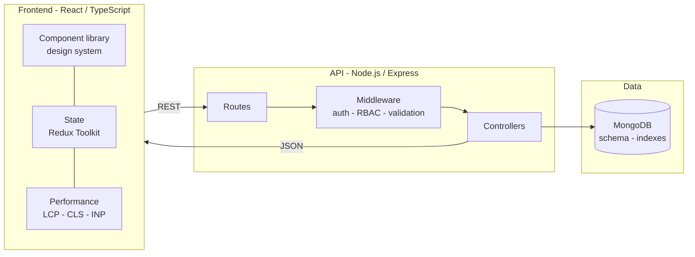

<h1 align="center">Vineet Arora</h1>

  <b>Full-Stack Software Engineer @ Jio Platforms</b> 
  React &amp; TypeScript on the front &middot; Node.js &amp; Express behind it &middot; Mumbai, India

  
  

---

### What I do

I ship **production web applications end to end** - from the React interface a customer touches, down through the REST layer, to the data behind it.

At **Jio Platforms** I build for **Jio.com** and **MyJio**, where "works on my machine" does not count because it has to hold up across SIT, replica and prod for real customers at national scale. Reusable component systems, API contract design with backend teams, Core Web Vitals, accessibility that actually matters, and Next.js where SSR earns its place.

Alongside that I build and ship my own **Node.js and Express services** - REST API design, JWT authentication, role-based access control, MongoDB - the same way I ship frontends: understanding every line, not just prompting one into existence.

---

### How I build

---

### Stack

**Frontend**

**Backend &amp; Data**

**Testing &amp; Delivery**

---

### Shipped at Jio

| Product | What I built | Scale |
|---|---|---|
| **Opinio Surveys** | In-house survey &amp; analytics platform - owned UX design, survey builder, response pipeline and real-time dashboards, end to end | 30+ teams &middot; 200K+ interactions |
| **Jio Devices storefront** | E-commerce catalog - dynamic pricing, discount rendering, category filtering, JioMart checkout | 6.3M+ visitors |
| **Jio AirFiber booking** | Built from scratch, including third-party integrations (Google Maps) | MyJio - 500M+ installs |
| **JioFiber Home Move** | Fiber relocation journey - serviceability lookup, appointment booking, request tracking | Jio.com |

---

### Building now

- **[Virtual Event Management Backend](https://github.com/vineethere/Backend-System-for-a-Virtual-Event-Management-Platform)** - Express REST API with JWT auth, role-based access control, event CRUD and async email notifications
- **[FinEdge](https://github.com/vineethere/FinEdge-NodeJs-Backend)** - Node.js + Express backend for a personal finance application
- **[DSA in JavaScript](https://github.com/vineethere/DSA-JavaScript-)** - daily problem solving

---

  
  

<i>Top 100 India &mdash; Snapchat AR Hackathon &nbsp;&middot;&nbsp; Top Performer &mdash; Coding Ninjas DSA (96%+)</i>

